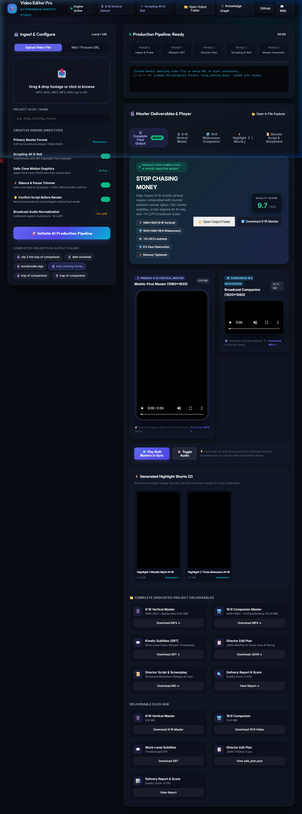

# Video Editor Pro 🎬🤖

An intelligent, autonomous agentic video & podcast production studio built to transform any input footage, audio podcast, URL, or infographic into broadcast-ready, highly engaging videos.

📖 **Full Documentation**: [Explore the Video Editor Pro Wiki](https://github.com/piyushk20/video-editor-pro/wiki)

## 🌟 Key Features

- **9:16 Vertical Master First**: Engineered for modern mobile-first consumption (TikTok, Reels, YouTube Shorts, vertical feeds) with ambient blurred backgrounds and sharp center framing.
- **⚡ Smart Silence & Pause Trimmer**: Autonomously detects dead air and awkward pauses using FFmpeg `silencedetect`, preserving natural breath cushions (80ms) and applying 20ms audio micro-crossfades to eliminate clicks and pops while boosting retention.
- **🖥️ Full Agentic Web Studio UI**: Modern dark-glass interface (`http://localhost:8090`) with drag-and-drop upload, YouTube/URL ingestion, live phase telemetry, and instant output player.
- **Intelligent Motion Graphics**: Generates bold, high-contrast title cards, speaker lower thirds, callout banners, and CTAs anchored strictly in the safe zones (never obstructing the speaker's face).
- **Cinematic B-Roll Integration**: Smooth Ken Burns pan/zoom camera moves and alpha crossfades synchronized to speech content.
- **Kinetic Subtitles**: Word-level synchronized subtitle generation with high-contrast outlines and drop shadows.
- **Broadcast Audio Mastering**: Audio normalized to standard -14 LUFS with studio noise reduction.
- **Dedicated Project Folders**: Self-contained per-project output structure containing master 9:16 episode, 16:9 companion, highlight shorts, SRT captions, transcripts, and director plans.

---

## 🎬 Complete Final Output Theater & Dual Master Showcase

The autonomous studio includes a dedicated, unified post-processing review theater that automatically activates upon pipeline completion:



- **Dual Split Master Theater**: Inspect both the 9:16 mobile-first vertical master (`1080×1920`) and 16:9 widescreen companion (`1920×1080`) side-by-side.
- **Synchronized Dual Playback**: Lock timeline playheads to preview composition and framing differences concurrently (`▶️ Play Both Masters in Sync`).
- **Highlight Shorts Shelf**: Instant hover previews and one-click downloads for all generated viral cutdowns.
- **Dedicated Deliverables Matrix**: Direct download links for video masters, word-level SRT subtitles, JSON director edit plans, markdown scripts, and quality audit reports.

---

## 🏗️ Architecture & Pipeline

The autonomous production workflow is organized into modular phases:

```
[Input: Video / Podcast / URL / Image]
               │
               ▼
   Phase 0: Input Handler & Silence Trimmer (FFmpeg silencedetect)
               │
               ▼
   Phase 1: Whisper Transcription & Semantic Analysis
               │
               ▼
   Phase 2: Director Planning (Edit Plan & Visual Cues)
               │
               ▼
   Phase 3: B-Roll Sourcing & Motion Graphics Generation
               │
               ▼
   Phase 4: Compositing, Audio Mastering & Assembly
               │
               ▼
[Deliverables: 9:16 Master + 16:9 Companion + Shorts + Subtitles]
```

### Phase Details

1. **Phase 0 — Input Handler & Silence Trimmer (`phase0_input_handler.py`, `silence_remover.py`)**:
   - Ingests local media, podcast audio, YouTube URLs, or infographic images.
   - Detects and trims awkward silences and pauses with natural speech cushioning.
   - Probes resolution, duration, framerate, and standardizes workspace paths.

2. **Phase 1 — Transcription & Semantic Analyzer (`phase1_analyser.py`)**:
   - Word-level timestamped transcription using Faster-Whisper.
   - Extracts hooks, key themes, filler word removal candidates, and natural chapter boundaries.

3. **Phase 2 — Creative Director (`phase2_director.py`)**:
   - Formulates pacing, b-roll trigger timestamps, kinetic caption timing, and graphic placements.
   - Outputs a structured `edit_plan.json`.

4. **Phase 3 — Visual Sourcing & Motion Graphics (`phase3_broll_sourcer.py`, `scrapling_broll_provider.py`, `generate_motion_graphics.py`)**:
   - Autonomously scrapes and downloads copyright-free stock video footage (Pexels, Coverr) using **Scrapling** with anti-bot resilience and zero API keys required.
   - Automatically matches requested orientation (9:16 vertical portrait or 16:9 landscape) and enforces visual variety across scenes.
   - Renders Ken Burns camera pan/zoom animations.
   - Creates bold RGBA motion graphic cards for upper/side safe zones.

5. **Phase 4 — Master Compositor (`phase4_editor.py`, `render_vertical_master.py`)**:
   - Assembles multi-layer vertical (1080×1920) or horizontal video.
   - Normalizes audio to -14 LUFS.
   - Burns synced subtitles and renders shorts.

---

## 📁 Repository Structure

```
video-editorpro/
├── .gitignore
├── GEMINI.md                    # Studio rules & aspect ratio specifications
├── README.md                    # Project documentation
├── output/                      # Dedicated output folders for each project (git-ignored)
└── agentic-video-studio/
    ├── .env.example             # Template for API keys (Pexels, Pixabay, etc.)
    ├── project.md               # Pipeline specification & workflow notes
    ├── run_pipeline.py          # Unified CLI pipeline runner
    ├── studio_server.py         # Web Studio FastAPI backend server
    ├── web/                     # Web Studio modern glassmorphism UI
    │   ├── index.html
    │   ├── style.css
    │   └── app.js
    ├── skills/                  # Autonomous agent skill definitions
    │   ├── podcast_to_video.md
    │   └── url_to_video.md
    └── tools/                   # Core production scripts & engines
        ├── phase0_input_handler.py
        ├── silence_remover.py
        ├── phase1_analyser.py
        ├── phase2_director.py
        ├── phase3_broll_sourcer.py
        ├── scrapling_broll_provider.py
        ├── phase4_editor.py
        ├── generate_motion_graphics.py
        ├── prepare_broll_clips.py
        └── render_vertical_master.py
```

---

## 🚀 Getting Started

### Prerequisites

- Python 3.10+
- FFmpeg (or `imageio-ffmpeg`)
- Python packages:
  ```bash
  pip install faster-whisper pillow imageio imageio-ffmpeg requests
  ```

### Configuration

Copy `.env.example` to `.env` (optional for external stock providers):
```bash
cp agentic-video-studio/.env.example agentic-video-studio/.env
```

### 🌐 Web Studio UI (Recommended)

Launch the interactive local Web Studio on port 8090:

```bash
python agentic-video-studio/studio_server.py
```

Open your browser to: **`http://localhost:8090`**
- **Drag & Drop Upload**: Upload any video file or paste a web/podcast stream URL.
- **Live 5-Phase Tracker**: Monitor real-time progress across Ingestion, Whisper Transcription, Director Plan, Scrapling B-Roll, and Master Assembly.
- **Interactive Mobile 9:16 Player**: Preview rendered 9:16 vertical masters with ambient blurred background and subtitles directly in the browser.
- **Highlight Shorts Carousel**: Browse and preview standalone highlight clips.
- **Deliverables & Explorer Hub**: One-click download of all files or open the `output/<project_name>/` folder directly in Windows File Explorer.

---

### Running via CLI

To run via command-line:

```bash
python agentic-video-studio/run_pipeline.py --input "path/to/source_video.mp4" --project-name "my_episode"
```

All deliverables are automatically organized in both:
- `output/<project_name>/`
- `agentic-video-studio/renders/<project_name>/`
  - `full_episode_9x16_vertical.mp4` (Primary 9:16 vertical master)
  - `full_episode_16x9_horizontal.mp4` (16:9 widescreen companion)
  - `shorts/` (Highlight reels)
  - `transcript.srt` (Word-level timestamped captions)
  - `edit_plan.json` (Director plan)
  - `review_score.json` (Quality audit)
  - `DELIVERY_REPORT.md` (Project summary & timestamps)

---

## 📜 License

MIT License.
